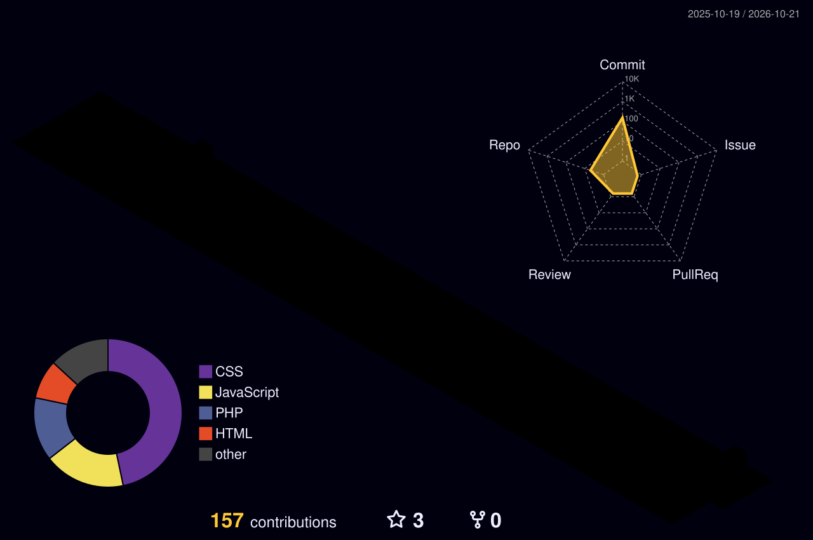

<!-- Animated header (waving gradient) -->

<!-- Typing animation -->

 

---

## 💫 About Me

WordPress Developer with **3+ years** of experience in WordPress development, PHP, MySQL, HTML5, CSS3, JavaScript, Elementor and WooCommerce.

- 🎨 Responsive web design
- 🧩 Theme and plugin customisation
- 🔍 SEO optimisation
- ⚡ Website performance and Core Web Vitals
- 🔒 Security, maintenance and troubleshooting

Proven ability to build **scalable, user-friendly, high-performance** websites in support of corporate and digital objectives.

 

---

## 💻 Tech Stack

  

---

## 🧊 3D Contribution Graph

<!-- Generated by the GitHub Action in .github/workflows/profile-3d.yml -->

  

---

## 🐍 Contribution Snake

<!-- Generated by the GitHub Action in .github/workflows/snake.yml -->

  <picture>
    <source media="(prefers-color-scheme: dark)" srcset="https://raw.githubusercontent.com/karthikkumarambati/karthikkumarambati/output/github-snake-dark.svg" />
    <source media="(prefers-color-scheme: light)" srcset="https://raw.githubusercontent.com/karthikkumarambati/karthikkumarambati/output/github-snake.svg" />
    
  </picture>

---

## 📊 GitHub Stats

 

---

## 🏆 Trophies

  

---

## 🤝 Let's Connect

<!-- Animated footer -->

