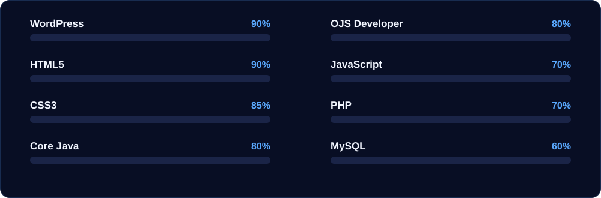
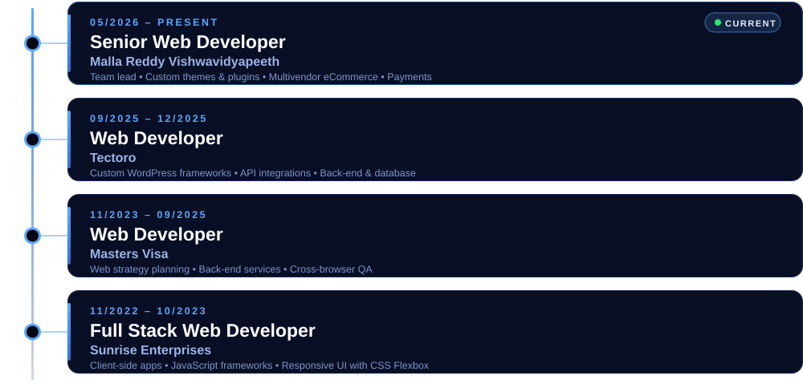
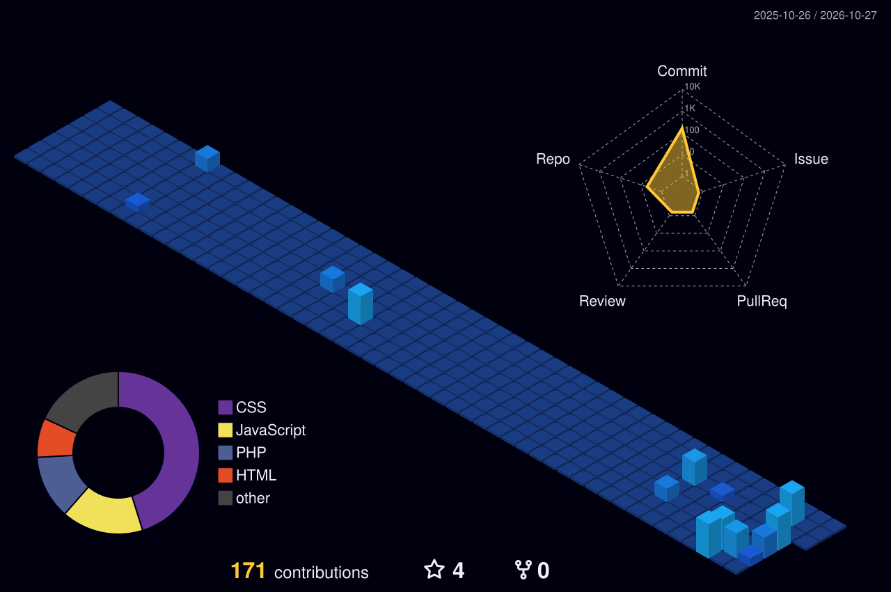

  

  

 

 

Senior WordPress Developer with 3+ years experience in WordPress development, PHP, MySQL, HTML5, CSS3,
Javascript, Elementor and WooCommerce. Responsive web design. Theme and plugin customisation. SEO
optimisation. Website performance. Core Web Vitals. Security. Maintenance and Troubleshooting . Proven ability to
build scalable, user-friendly, high-performance websites in support of corporate and digital objectives.

- 🧩 Custom theme and plugin development
- 🛒 WooCommerce, multivendor stores and payment integrations
- 🎨 Responsive, pixel-perfect UI with Elementor, HTML5 and CSS3
- ⚡ Core Web Vitals, performance tuning and SEO optimisation
- 🔒 Security, maintenance and troubleshooting
- 👥 Code reviews, mentoring and task allocation

 

 

  

 

 

 

 

 

 

More on my [portfolio](https://karthikkumarambati.github.io/karthik_kumar/)

 

 

<!-- Generated daily by .github/workflows/profile-3d.yml -->

 

<!-- Generated daily by .github/workflows/snake.yml -->
<picture>
  <source media="(prefers-color-scheme: dark)" srcset="https://raw.githubusercontent.com/karthikkumarambati/karthikkumarambati/output/github-snake-dark.svg" />
  <source media="(prefers-color-scheme: light)" srcset="https://raw.githubusercontent.com/karthikkumarambati/karthikkumarambati/output/github-snake.svg" />
  
</picture>

 

 

 

 

 

 

**Have a website project in mind?** I build modern, responsive, SEO-friendly WordPress and WooCommerce websites.

