 

<!-- Generated daily by .github/workflows/profile-3d.yml -->

<!-- Generated daily by .github/workflows/snake.yml -->
<picture>
  <source media="(prefers-color-scheme: dark)" srcset="https://raw.githubusercontent.com/karthikkumarambati/karthikkumarambati/output/github-snake-dark.svg" />
  <source media="(prefers-color-scheme: light)" srcset="https://raw.githubusercontent.com/karthikkumarambati/karthikkumarambati/output/github-snake.svg" />
  
</picture>

 

